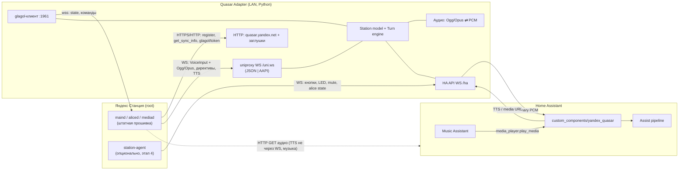
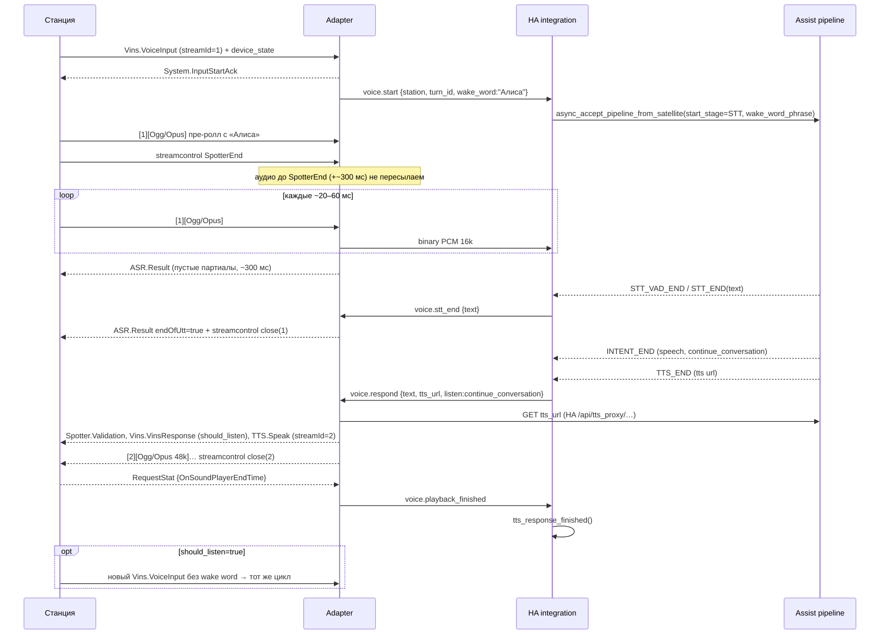

# Архитектура

## 1. Цель

Станция остаётся «железом»: микрофоны, VQE, споттер «Алиса», динамик, LED и кнопки. Весь «мозг» переезжает в Home Assistant:

- голос → HA Assist pipeline (STT → conversation/intent → TTS) → ответ звучит на станции;
- HA управляет воспроизведением: громкость, пауза, `play_media` для Music Assistant, TTS-объявления;
- статус связи, а позже кнопки, LED и мьют микрофона видны в HA как сущности.

Облако Яндекса **полностью заменяется** нашим сервером. Алиса, умный дом Яндекса и Яндекс Музыка через облако на станции больше
не работают. Гибридный режим (проксировать в Яндекс то, что HA не обработал) отложен, см. [roadmap.md](roadmap.md).

## 2. Компоненты



### 2.1 Quasar Adapter (`adapter/`, Python-пакет `quasar_adapter`)

Отдельный сервис в LAN: Docker-контейнер, HA add-on или просто venv. Python + asyncio + aiohttp, чтобы стек совпадал с HA
и чтобы адаптер при желании можно было встроить в интеграцию (см. §4.1).

Обязанности:

1. **Эмуляция облачного бэкенда** (`quasar.yandex.net` и заглушки oauth/passport/startup/appmetrica/clck/scbh/rpc).
   Без них станция не активируется и не считает себя онлайн. Отдаём согласованный `get_sync_info`: `uniProxyUrl` на нас,
   OTA выключены, unbound не уводит DNS к Яндексу. Мы же выдаём и проверяем glagol-JWT.
2. **uniproxy-сервер** (`/uni.ws`). Сессии станций; кодеки протокола: JSON (прошивки ~1.x) и бинарный protobuf `AAPI`
   (3.x), определяются автоматически по первому кадру. Наружу кодеки отдают **одну нормализованную модель событий
   и директив** ([station-protocol.md](station-protocol.md)).
3. **Turn engine**: машина состояний одного «хода» диалога. VoiceInput → аудио в HA → endOfUtt станции → ответ
   (VinsResponse + TTS.Speak + Ogg/Opus) → ожидание окончания речи. Там же «ходы», которые начинает сервер
   (announce, start_conversation, play_media), реализованные через push-бумеранг (§3.3).
4. **Аудио**: демукс Ogg и декодирование Opus 16 кГц в PCM s16le 16 кГц моно для HA. Транскод TTS из HA
   (WAV/MP3) в Ogg/Opus 48 кГц для станции. Библиотеки: PyAV (libopus, libavformat), запасной вариант — ffmpeg subprocess.
5. **glagol-клиент**. Адаптер сам подключается к локальному glagol станции (`wss://<ip>:1961`) с токеном, который сам
   же и выписал. Отсюда push-состояние (aliceState, playerState, громкость, текущий трек) и точные команды
   (setVolume 0..1, play/stop/next/prev/rewind). Это основной источник состояния для `media_player`. Если glagol
   недоступен (например, на Станции 3), используется fallback: `device_state` из событий uniproxy и SyncPush
   GetDeviceState (AAPI).
6. **HA API** (`/ha`): WebSocket, адаптер — сервер, HA — клиент. Список станций, их состояние, голосовые потоки,
   команды. Анонс через zeroconf `_quasar-adapter._tcp`. Протокол: [adapter-ha-api.md](adapter-ha-api.md).

### 2.2 HA custom integration (`custom_components/yandex_quasar/`)

Домен `yandex_quasar`, чтобы не конфликтовать с популярной `yandex_station` от AlexxIT. `iot_class: local_push`.
Один config entry на адаптер, каждая станция — отдельное HA-устройство (dynamic devices). Сущности на станцию:

| Платформа | Сущность | Этап |
|---|---|---|
| `assist_satellite` | голосовой ассистент: wake word «Алиса» на устройстве, announce, start_conversation | 2 |
| `select` | Assist pipeline и VAD sensitivity (стандартные `AssistPipelineSelect` / `VadSensitivitySelect`) | 2 |
| `sensor` | `sensor.<station>_status`: ENUM `online / station_offline / adapter_offline`, diagnostic | 2 |
| `media_player` | громкость, пауза/плей/стоп, next/prev, `play_media` (MA, media_source, TTS), announce | 3 |
| `event` | кнопки: action / play / vol± / mute, типы `short_press / long_press / double_press` | 4 |
| `light` | LED-кольцо или экран: цвет, яркость, эффекты | 4 |
| `switch` | мьют микрофона | 4 |

Подробности: [ha-integration.md](ha-integration.md).

### 2.3 station-agent (`station-agent/`, этап 4, опционально)

Маленький статический бинарник на Go (`GOARCH=arm64`, без CGO) в `/data/opt/bin`, автозапуск через `/etc/init.d/S99z…`.
Нужен для того, чего нет в облачном протоколе:

- кнопки: чтение `/dev/input/event*` (evdev допускает нескольких читателей, maind продолжает работать);
- LED: sysfs `/sys/class/leds/*` или `/dev/fb0` в зависимости от модели, проигрывание `ledpatterns/*.led` через `led_util`,
  восстановление штатного trigger;
- мьют микрофона: состояние из `mute-switch` и программное переключение через `EV_SW SW_MUTE_DEVICE`;
- точное состояние Алисы (IDLE/LISTENING/BUSY/SPEAKING) и события TTS_STARTED/TTS_COMPLETED через IPC `aliced`
  на `127.0.0.1:9875`. Это закрывает проблему «когда станция договорила», если glagol её не решает.

Агент подключается к адаптеру (а не напрямую к HA), чтобы у HA был один источник данных о станции, а адаптер
мог сам использовать события агента, например в turn engine.

## 3. Ключевые потоки

### 3.1 Голосовой запрос (wake word на станции)



Решения:

- **Wake word остаётся на станции** (`start_stage=STT`, `wake_word_phrase="Алиса"`). Так работает мастер Voice Setup,
  а станция не стримит микрофон постоянно. Слово активации меняется только между `alisa`/`yandex`
  (через `account_config.spotter`). В `AssistSatelliteConfiguration` отдаём оба, `max_active_wake_words=1`.
- **Конец фразы решает VAD в HA.** Адаптер переводит `STT_END`/`STT_VAD_END` в `endOfUtt` для станции. Страховка
  в адаптере: `max_utterance` (~10 с) и no-speech timeout, по которым адаптер сам закрывает ход и шлёт в HA
  `voice.stop`. Если HA сообщает ошибку пайплайна, отвечаем станции пустым VinsResponse и проигрываем звук ошибки.
- **TTS идёт через `TTS.Speak`, а не через `audio_play`.** Ответ звучит в канале Dialog: LED «говорит», дакинг музыки,
  перебивание голосом, `should_listen`. Плеер музыки при этом не трогается. Адаптер скачивает TTS из HA (в `tts_options`
  просим `wav`, 16–24 кГц, моно), транскодирует в Ogg/Opus 48 кГц и стримит по мере готовности, страницами по ~100 мс.
- **Follow-up нативный.** `continue_conversation` → `should_listen=true` в VinsResponse. Станция сама снова открывает
  микрофон и присылает VoiceInput без wake word, интеграция запускает pipeline с `start_stage=STT` без `wake_word_phrase`.
  `conversation_id` HA подхватывает сам через `chat_session`.
- **Окончание речи** (для `tts_response_finished()` и `async_announce`): основной сигнал — `RequestStat`
  с `Timestamps.OnSoundPlayerEndTime`. Станция шлёт его сама после проигрывания ответа (подтверждено на Midi,
  см. [device-notes.md](device-notes.md)). Страховка — рассчитанная длительность аудио + 2 с.

### 3.2 Воспроизведение медиа (media_player, Music Assistant)

`media_player.play_media(url)` → интеграция резолвит `media-source://` и делает `async_process_play_media_url`.
Затем `media.play {url, metadata}` → адаптер → push-директива `audio_play {stream.url, metadata, callbacks}`.
Станция сама скачивает URL плеером mediad (GStreamer).

- Состояние (playing/paused/idle, позиция, громкость, трек) приходит из glagol-стрима, при его отсутствии — из колбэков
  `on_started/on_stopped/on_finished/on_failed` и из `device_state`.
- `media_content_id` = реально играющий URL. Music Assistant по нему узнаёт свой flow-стрим.
- Риски, которые проверяются на этапе 0: бесконечный HTTP-стрим MA (MP3 без Content-Length), FLAC, редиректы
  (старый GStreamer не проходит 308; адаптер может сам раскрывать редиректы, как quasard).
- Команды: `player_pause`/`player_continue`/`player_next_track`/`player_previous_track`, `clear_queue` (stop),
  `audio_player_rewind`, `sound_set_level` (0..10). Если доступен glagol, используются его команды (громкость 0..1).
- `announce=True` уходит в путь announce (§3.3). Музыку станция дакает или ставит на паузу сама.

### 3.3 Ходы, которые начинает сервер (announce, start_conversation, push TTS)

Станция ожидает аудио ответа внутри «хода», начатого ею самой. Поэтому используем приём quasar-server, бумеранг:

1. Адаптер пушит в открытую uniproxy-сессию server_action с нашим уникальным `turn_id`. В AAPI это
   `@@mm_semantic_frame` с `tts_semantic_frame`, для JSON-протокола вариант проверяется на этапе 0.
2. Станция возвращает его как TextInput/server_action.
3. Адаптер отвечает подготовленным ходом: VinsResponse (+`should_listen` для start_conversation) + TTS.Speak +
   Ogg/Opus (TTS или любой аудио-URL, перекодированный в opus, в том числе preannounce-звук).

Отсюда:

- `assist_satellite.announce` → ход с аудио, затем ждём `playback_finished`;
- `assist_satellite.start_conversation` → тот же ход с `should_listen=true`, станция слушает без wake word;
- `media_player.play_media(announce=True)` → тот же путь.

Запасной вариант на случай, если бумеранг не работает на конкретной прошивке: `audio_play` с URL аудио (с потерей
восстановления музыки), а через station-agent — `START_VOCALIZE` в aliced.

## 4. Принятые решения и альтернативы

### 4.1 Адаптер отдельным сервисом, а не внутри HA

- Станции нужны порты и пути, которые неудобно поднимать внутри HA. Самое главное — HTTP с путями `quasar.yandex.net`;
  если станцию перенаправлять через DNS, нужен ещё и 443 с TLS.
- Адаптер можно перезапускать, отлаживать (`log_traffic`) и тестировать симулятором станции без HA.
- Протокол станции изолирован от HA API. Интеграция знает только наш стабильный протокол.

Пакет `quasar_adapter` пишем как библиотеку без глобального состояния. Если позже захочется, интеграция поднимет его
сервер в процессе HA (как `voip` поднимает SIP) — режим «встроенный адаптер».

### 4.2 Перенаправление станции: правка `quasar.cfg`, а не DNS

На root-станции правим `/system/vendor/quasar/quasar.cfg`: `backendUrl=http://<adapter>:<port>`,
`uniProxyUrl=ws://<adapter>:<port>/uni.ws`. Для `http://` и `ws://` прошивка не включает TLS вообще. Нет CA,
сертификатов и войны с unbound/DnsFallbackMap. Остальные хосты (oauth, passport, scbh, metrics) перекрываются
правкой соответствующих ключей cfg, если они есть, а иначе — записями в `/etc/hosts` или DNS. Полный список ключей
определяется на этапе 0. Резервный путь — DNS + свой CA в `ca-certificates.crt` (как у quasard). Адаптер поддерживает
оба способа: маршрутизация по `Host` и по префиксу пути `/<host>/…`, плюс опциональный TLS-листенер.
Подробности: [station-setup.md](station-setup.md).

### 4.3 Протокол адаптер ↔ HA: свой WebSocket, а не Wyoming

Wyoming-сателлит дал бы `assist_satellite` бесплатно, но не покрывает media_player, LED, кнопки и несколько станций
на одном соединении. Для HA пришлось бы держать две интеграции. Свой протокол небольшой (JSON + бинарные PCM-кадры),
а сущности пишем по образцу `wyoming`/`esphome`.

### 4.4 Состояние станции: glagol как основной источник

uniproxy даёт `device_state` только в моменты запросов. glagol — push-стрим, и его же использует AlexxIT/YandexStation,
так что формат хорошо известен. Токены выписывает наш же `quasar.yandex.net`, а сертификат glagol-сервера мы отдаём
в `get_sync_info.glagol.security`. Если glagol на модели не работает, используются fallback'и (§2.1 п. 5) и station-agent.

### 4.5 Язык и библиотеки

- Адаптер: Python ≥ 3.12, aiohttp (HTTP и WS серверы), `protobuf` (сгенерированные из quasar-protos модули, только
  нужное поддерево `alice/protos/api/alicekit` и зависимости), PyAV (Opus/Ogg), `zeroconf`, `pydantic` для конфига,
  pytest + симулятор станции.
- Интеграция: только stdlib + aiohttp из HA, без внешних зависимостей (`requirements: []`). Протокольные модели
  лежат в общем модуле `quasar_adapter/ha_api/schema.py` и **копируются** в интеграцию скриптом синхронизации,
  чтобы интеграция не зависела от пакета адаптера.
- station-agent: Go, статическая сборка, без зависимостей от libc прошивки.

## 5. Структура репозитория (целевая)

```
adapter/
  pyproject.toml
  quasar_adapter/
    __main__.py            # CLI: serve, gen-config, sim
    config.py              # YAML/ENV конфиг
    backend/               # HTTP: quasar.yandex.net, sync_info, glagol tokens, заглушки
    uniproxy/
      server.py            # WS /uni.ws, сессии
      codec_json.py        # JSON-протокол (~1.x)
      codec_aapi.py        # protobuf AAPI (3.x)
      model.py             # нормализованные события и директивы
      directives.py        # конструкторы: audio_play, sound_set_level, tts_play_placeholder, …
    turns.py               # turn engine (voice / server-initiated)
    audio/                 # ogg demux, opus decode/encode, транскод TTS
    glagol/client.py
    station.py             # модель станции и её состояние, реестр
    ha_api/                # WS-сервер для HA, schema.py
    proto/                 # сгенерированный protobuf
  tests/                   # unit + сценарии с симулятором станции
  tools/station_sim.py
  Dockerfile
ha-addon/                  # обёртка add-on для HA OS
custom_components/yandex_quasar/
  __init__.py  manifest.json  config_flow.py  const.py  client.py  entity.py
  assist_satellite.py  select.py  sensor.py  media_player.py  event.py  light.py  switch.py
  diagnostics.py  strings.json  translations/{en,ru}.json  quality_scale.yaml
station-agent/             # Go, этап 4
docs/
hacs.json
```

## 6. Безопасность

- HA API адаптера защищён общим токеном (`api_token` в конфиге адаптера, вводится в config flow), слушает LAN.
- Эмуляция бэкенда принимает любые OAuth-коды: это нормально, станция доверяет нам по конфигу. Наружу из LAN эти порты
  не открывать.
- `devices.json` и `glagol.security` — секреты станции. Не коммитить, не писать в логи, в `diagnostics` редактировать.
- Траффик-лог (`log_traffic`) только для отладки, по умолчанию выключен: в нём аудио и токены.
